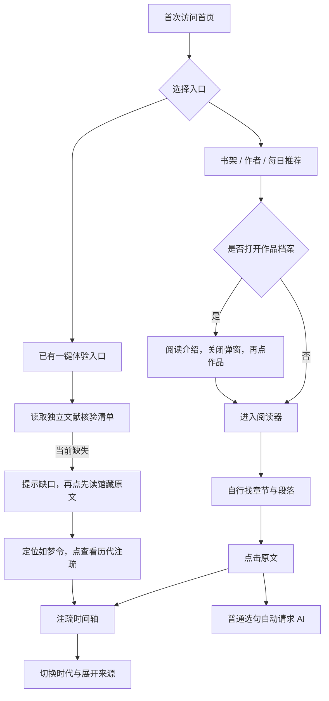
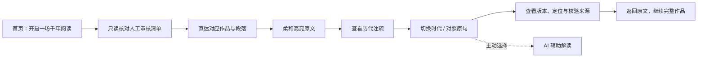

# NotesTimeMachine 首次使用体验 V2

更新日期：2026-11-06（Asia/Hong_Kong）。范围：首页入口、游客阅读、作品详情、原文定位、注疏对照、公开导航与移动交互。**交互实现可验收；真实“已人工核验原文＋两条不同时代注疏”样本仍为 BLOCKED。**

本轮完善已有「开启一场千年阅读」按钮，没有重复增加入口，没有生成历史注疏、改写生产数据或绕过内容核验。未修改后端、部署、提交或推送 main。上一版文档完整保留为 [历史快照](activation-evidence/2026-11-06/USER-ACTIVATION-V2-previous.md)。

## 1. 原有用户路径

以下是本轮开始时的实际代码路径，不能把更早版本的问题当成当前现状。

已有游客权限允许阅读原文和注疏，**登录并非原有强制步骤**。作品详情是可选入口。主要阻力是：

- 无明确目标的新用户需要选书、理解章节结构、手工找段落，才看到多时代对照。
- 作品档案缺直接阅读按钮，还存在社区遮罩样式覆盖作品弹窗内容、吞掉点击的问题。
- 普通选句自动发起 AI 请求，增加等待和服务依赖，掩盖原文与注疏本身的价值。
- 载入作品前还等待独立健康检查；健康接口失败不应阻止直接尝试读取公开章节。
- 阅读地址以 replaceState 为主，没有完整的首页/书架历史入口；返回来源与继续阅读的位置不稳定。
- 一键体验虽然已有定位/门控，但真实文献清单缺失，不能将这个分支说成可上线的核验示例。

## 2. 优化后的路径

### 合格文献接入后的路径

核心步骤无需注册，不自动调用实时 AI。入口直接定位；阅读指引让用户先读原文，再主动展开注疏，而不是一次塞入全部面板。作品档案现在可以直接「阅读这部作品」。

### 当前真实数据可用的路径

首页入口 → 明确提示“已核验体验文献尚未备齐” →「先读馆藏原文」→ 实际馆藏《漱玉词》shuyuci-01-01 → 定位/高亮 →「查看历代注疏」→ 对照**待核验馆藏记录**、查看来源 → 继续阅读。这里不能称为“已人工核验的历史对照示例”。

读取核验清单失败时，展示重试和书架入口，不用静态假数据冒充在线结果。AI 不可用时，仅影响用户主动请求的 AI 区域，原文、时间轴和来源仍可用。

## 3. 文献门槛与真实数据缺口

本轮沿用现有只读 `/api/activation/example`，没有增加或修改后端逻辑。它要求独立 R2 清单 `metadata/activation-example.json`，并回查实际正文：

- 已审核原文，以及至少两条不同时代、适合对照的历史注疏。
- 来源 ID、题名、作者、时代、版本、卷页/定位、可访问文献链接、正文 SHA-256、审核编号与日期完整。
- 正文、作者、时代与实际馆藏一致；重复、AI 生成、现代解释、缺字段或哈希变化均不能作为体验依据。
- 前端加载对应章节后再次检查原文和获准注疏；变化则退出核验模式、提示需重审，继续保留普通阅读。

同日发布前验收的真实读取为 `available=false / verified_example_missing`，见 [真实读取证据](release-evidence/2026-11-06/activation-live.json)。本轮未创建或上传清单，后端及源数据未变。此前仅核查了三个原文片段/署名，**不构成两条历史注疏的人工审核**，见 [发布验收报告](AI-RELEASE-READINESS.md) 和 [来源账本](../evaluations/ai/source-review-registry.json)。

优先候选仍为首页《如梦令》段落及胡仔、陈郁、沈际飞、王士禛、黄蓼园等旧记录。需要具备文献能力的审核者逐条核对真实版本、定位、署名、时代、全文及与该段的关系，选出至少两条有实质对照价值的注疏后再形成清单。字段齐全或哈希吻合不能代替人工审查。

**完整真实核验体验：BLOCKED。** 浏览器测试使用醒目标为 TEST ONLY 的审核夹具，仅证明交互/门控分支，不是人工核验结果，也没有写入产品数据。

## 4. 核心交互实现

### 阅读与 AI 分离

`selectParagraph` 默认只展示馆藏注疏和显式「查看 AI 辅助解读」。普通选句、一键体验、刷新定位、切换时代和查看来源均不发 `/api/analyze` 或 interpret 请求。保留显式 AI 请求的取消与版本隔离，旧返回不能覆盖新段落。AI 请求失败后仍保留历史面板。

公开文献请求统一 `credentials:omit`，不附社区 Authorization。匿名阅读不调用进度写入。已登录用户继续使用原有鉴权进度保存，前后端权限判断没有被改成匿名可写。

### 定位、刷新与返回

- `#experience` 每次刷新重新读取核验清单，不从本地缓存制造审核身份。
- `#read/{classic}/{chapter}/{paragraph}` 恢复正确作品/章节/原文高亮；刷新后由用户再次展开注疏，不自动请求 AI。
- 首页、作者、书架、社区及阅读入口使用公开页面历史；浏览器返回/前进能在首页和阅读位置之间恢复。应用内阅读返回优先回到本站前一入口，直接访问没有本站前项时回书架。
- 「继续阅读完整作品」及面板底部「返回原文，继续阅读」关闭面板、退出引导、保留段落地址与高亮，并把焦点/视线回到原句；无需重新选书或跳到下一章。
- 离开阅读使迟到的章节/段落响应失效，离开首页取消迟到的体验响应，防止旧响应改变当前页面和地址。不同作品切换会清空旧选句、时间轴、引导及 AI 请求。

公开地址不含账号或凭证；没有新增私人的长期阅读历史存储。

### 游客与登录

游客可访问首页、书架、作者、作品档案、原文、公开注疏、时间轴和来源详情。登录按钮不是必经步骤。点赞/发帖沿用原有主动操作时提示登录；本轮补齐主动点击评论时的登录提示，未提交匿名评论。现有收藏功能/接口不存在，本轮不新增假的收藏按钮或开放写权限。

## 5. 视觉、移动与动效

沿用 V2 的纸色、墨色、朱砂/青绿和现有字体层级，保留深色模式，没有引入动效库或重做页面。

移动端采用**页面内触屏注疏面板**，不是模态底部抽屉：它不会锁住页面或迫使用户在浮层里读长文。标题/关闭栏在阅读时固定可达，时代节点及来源 summary 至少 44px，底部有全宽返回原文按钮；375/390 下指引和错误状态按钮全宽。面板有独立 region 名称与可聚焦标题，节点以 aria-pressed 表达选择，阅读指引同步 aria-expanded，来源使用原生 details/summary，无 hover 才能完成的操作。

修正了作品详情遮罩层级，阅读按钮不再被遮罩吃掉。时代筛选按真实 era 字段，不再因共用颜色将魏晋/未知时代归入汉代。

动效按照 motion-anything 的 MOTION-SPEC 和现有 fade-in-up 方向执行：

| 反馈 | 实现 |
| --- | --- |
| 首页主入口 | 随已有 hero 分组轻量渐入，不再添加一层按钮动画 |
| 定位原文 | focusText 的 180ms 透明度提示和稳定高亮，无循环闪烁 |
| 展开时间轴 | 现有 280ms 面板渐入，最多两个节点 stagger，控制同时入场数量 |
| 切换注疏 | 220ms 内容过渡，不对长正文做逐行滚动动画 |
| 阅读导航 | 阅读器不再叠加整页入场；不等待动画才能阅读 |
| 减少动态效果 | prefers-reduced-motion 下即时呈现、非平滑定位，无活动装饰动画 |

没有新增滚动监听、持续 RAF、粒子、自动庆祝或布局尺寸动画。只有用户操作引起内容反馈，不人为加入等待。

## 6. 修改文件

以下是本轮增量，不把原工作区已有的后端/UI 改动算成本轮新增。

| 文件 | 本轮内容 |
| --- | --- |
| `index.html` | 首页说明、时间轴 region/标题、返回原文按钮、按需 AI 文案 |
| `css/components.css` | 触屏尺寸、移动面板标题、来源展开目标、状态按钮、作品遮罩修复 |
| `js/readingRoute.js`、`js/state.js` | 公开页面历史与不新增历史项的恢复模式 |
| `js/main.js` | 非阻塞启动、阅读返回/恢复、离开后取消、继续阅读动作 |
| `js/ui/activation.js` | 历史入口、核验成功直达、网络重试/书架分流 |
| `js/ui/reader.js` | 默认按需 AI、避免重复健康等待、位置保留、迟到响应失效 |
| `js/ui/timeline.js` | 真实时代筛选、指引展开状态、回原文焦点 |
| `js/ui/bookDetail.js` | 详情直接阅读按钮 |
| `js/ui/community.js` | 只有主动评论时提示游客登录 |
| `js/api.js` | 公开文献请求不附账户凭证 |
| `js/motion/index.js` | 阅读器不叠加整页动画 |
| `tests/regression.js` | 保留原回归，新增按需 AI/导航取消/时代筛选；显式 AI 竞态测试继续保留 |
| `tests/browser-activation.cjs` | 独立本机服务器 + 真实 Chrome 全流程/触屏/刷新/异常验收，接口全部隔离 |
| `docs/USER-ACTIVATION-V2.md`、`docs/activation-evidence/2026-11-06/` | 本轮说明、原始结果、四档截图及历史文档备份 |

没有修改后端源代码、Schema、Wrangler 配置、生产数据库或知识库 JSON。

## 7. 测试结果与边界

当前结果见 [browser-flows.json](activation-evidence/2026-11-06/browser-flows.json)、[模块回归](activation-evidence/2026-11-06/module-tests.json) 和 [后端结果](activation-evidence/2026-11-06/backend/tests.txt)。

| 检查 | 结果 |
| --- | --- |
| 前端模块回归 | 35/35 PASS，包含原有功能及显式 AI 的取消/竞态保护 |
| 真实 Chrome 场景 | 17/17 PASS（其中一组为上述模块回归）；覆盖四档完整链路及异常/登录/刷新/键盘场景 |
| 四档视口 | 375、390、768、1440 均无页面横向溢出；节点/来源触点达到约 44px |
| 触屏 | 三个移动/平板档实际发送 Chrome touchStart/touchEnd，无 hover 前提；1440 使用鼠标 |
| 游客 | 全程无登录弹窗、无进度 POST、核心流程无 AI 请求 |
| 已登录 | 同样不自动请求 AI；仅进度写入走既有 Authorization，公共读取不带账号 |
| 主动评论 | 游客操作后才出现登录框，没有匿名写入评论 |
| 页面刷新/返回 | 正确作品/段落恢复，体验地址重新核验，浏览器后退/前进可用 |
| 异常 | 网络可重试、清单缺失、章节/段落不存在、章节网络异常、迟到响应与跨作品清理 |
| AI 服务不可用 | 仅主动点击后请求一次；失败后仍可查看注疏 |
| 减少动效 | 流程可用，检查时活动动画为 0 |
| 后端严格类型检查/隔离回归 | PASS，90/90；鉴权、D1 用户隔离、来源门控等仍通过 |
| 真实已核验多时代体验 | BLOCKED：没有获人工审核的合格文献清单 |

浏览器使用真实产品 HTML/JS/CSS，但 API 均由测试夹具控制，**不是生产端到端成功或文献真实性证明**；已登录身份也是隔离测试身份。设备尺寸/触屏为 Chrome 模拟，尚未进行实体 iPhone/Android 或 Safari 验收，不宣称实体机性能达标。

本轮发现的作品遮罩点击问题已修正。测试中的像素浮点误差、旧缓存、临时静态服务加载失败和新文档等待问题均单独保留记录；最终结果禁用缓存、使用独立本机服务，并等待真正新文档，未将旧 32 项结果当成本轮 35 项。旧测试证据已备份/恢复，本轮结果另存。

复现：先安装项目已有后端依赖，确保本机 Chrome 可用，然后在项目根目录运行 `node tests/browser-activation.cjs`；可用 CHROME_BIN 指定浏览器路径。脚本自行启动临时静态服务，所有业务请求由测试拦截，不需要真实登录或 AI 额度。后端运行 `cd cf-worker && npm run typecheck && npm test`，注意原测试默认会覆盖历史结果，保留历史时先备份。

## 8. 遗留问题与下一步

1. **内容阻断**：必须先补人工审核清单，至少一段原文和两条不同时代、确有对照价值的历史注疏。不能用本轮 TEST ONLY 夹具或原文片段核对结果替代。
2. **上线一致性**：同日验收发现线上 activation 接口为 404，工作区路由则可返回缺口；本轮未部署，不能宣称线上已具有这些交互和日志。发布前需核对前后端版本并验收真实只读路径。
3. **既有服务风险**：AI 真实质量、历史出处和 Socket 根因仍按 AI-RELEASE-READINESS.md 的 FAIL/BLOCKED 处理；本轮通过让 AI 按需开启降低核心阅读依赖，没有宣称修复这些问题。
4. **设备与用户验证**：合格资料到位后，补实体机浏览器和少量文学读者测试，观察能否自主完成“原文—两条注疏—来源—继续阅读”，再决定是否扩展。

完成状态：游客阅读与首次体验交互已完善；具备真实人工核验资料的一键体验仍等待内容交付。未执行部署、生产数据修改、提交或 main 推送。
