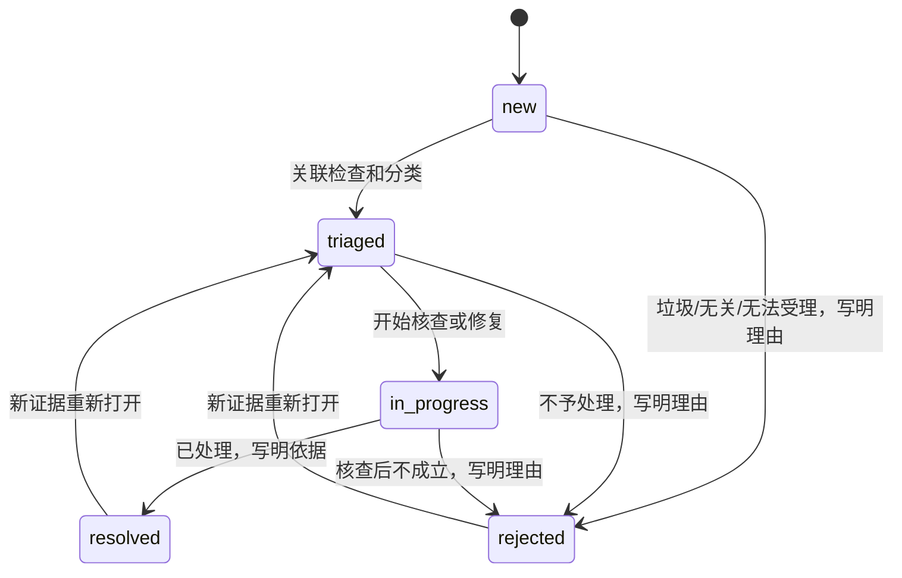

# NotesTimeMachine 用户反馈与文献纠错

日期：2026-11-06。本轮交付为可本地验证的最小反馈闭环：匿名提交 → 内部筛选查看 → 分流处理 → 留下结案依据。生产反馈开关仍为 false，未执行生产迁移或部署，未提交、推送 main。

## 1. 现状审计与复用

已有 `js/ui/feedback.js`、`POST /api/feedback`、`GET /api/feedback/availability` 和 `001-content-feedback.sql` 提案。已有匿名评分、五类问题、可选说明、文献关联校验及 submission_id 幂等写入，因此本轮直接扩展，没有增加第二套反馈存储或统计工具。

已有社区帖子、评论、点赞和阅读进度使用社区鉴权，适合公开讨论或账号功能，不能代替私有问题核查。本轮不改变这些权限，也不将反馈发布成评论。阅读与来源查看仍是公开功能；反馈请求使用 credentials=omit，不附带社区 Bearer Token。

原有不足：阅读器缺少反馈入口；历史注疏来源详情没有直接纠错操作；无基础限流、允许来源校验、状态处理或内部查看方式；失败提示没有明确重试按钮；表单收起后的焦点和视口需完善。

## 2. 用户入口与交互

| 位置 | 入口与行为 |
| --- | --- |
| AI 分析 / 单条注疏 AI 解读结果 | 实际生成结果显示“这段解读对你有帮助吗？”以及“有帮助 / 没有帮助 / 反馈问题”；未生成或被扣留的结果只提供问题反馈，不将空结果评为有帮助 |
| 历史注疏来源详情 | “纠正引用或出处”打开同一条注疏已有的反馈表单，预选“引用或出处错误”，不再创建重复表单 |
| 阅读器核心区域 | 定位/选择原文后，在原文操作区显示“阅读中遇到问题？”及轻量问题入口，关联当前作品与段落 |

问题类型沿用已有内部值，避免破坏旧数据及产品埋点：

| 展示文案 | issue_type |
| --- | --- |
| 内容不准确 | inaccurate_content |
| 引用或出处错误 | questionable_source |
| 解释不清楚 | unclear_explanation |
| 页面操作问题 | interaction_problem |
| 其他 | other |

问题类型必选，说明自愿、最多 500 个 JavaScript 字符长度单位；留空说明仍可提交。纯“有帮助/没有帮助”不需要分类和说明。没有强制登录、浮层、遮罩或等待反馈完成的阅读门槛。

反馈是当前内容旁的内联表单。打开时聚焦分类；原生标签、required、aria-invalid 和关联状态文本支持键盘与错误识别。Escape / 取消收起表单，返回真实触发按钮；成功收起后也返回该按钮，并在必要时让它回到可见位置，避免移动端焦点离屏。状态使用 live region，忙碌时禁用提交按钮并设置 aria-busy，触屏按钮最低 44px。动效复用现有 switchContent，遵守减少动效偏好。

成功只有在服务返回 `received:true` 后显示“已收到反馈，谢谢你帮助我们改进。”；服务未启用、网络异常、数据库异常及未知回执不会冒充成功。失败保留输入，显示“重试提交”；同一未改动内容沿用原 submission_id。没有后台自动重试或离线正文队列。刷新不自动重放反馈，也不在浏览器持久保存自愿说明。

## 3. 数据模型

沿用 D1 的 `content_feedback`，内部 `classic_id` 通过 review view / API 映射为 `work_id`。旧接口 classic_id 仍被接受；同时给出 work_id 和 classic_id 时必须一致。

| 表 / 视图 | 内容 |
| --- | --- |
| content_feedback（已有提案） | submission_id 主键；classic_id、paragraph_id、可空 annotation_id；target、rating、可空 issue_type / note / prompt_version / model；payload_hash；服务端 created_at |
| feedback_workflow（新增） | submission_id 一对一外键；status、version、可空 ai_response_id、last_change_id、服务端 updated_at |
| feedback_status_history（新增） | change_id 主键；反馈编号、from_status、to_status、from_version、可选 reason、payload_hash、created_at |
| feedback_rate_limits（新增） | 短期 bucket_key、计数与到期秒数；不含原始网络地址或账号 |
| feedback_review（新增视图） | 合并反馈和状态，输出 work_id；旧反馈缺状态行时按 new / version=0 查看，无需重写历史记录 |

target：reading / annotation / ai_analysis / annotation_interpretation。annotation 和 annotation_interpretation 必须带真实 annotation_id；其他目标不能误关联注疏。helpful / unhelpful 的 issue_type 必须为空；problem 必须带五类中的一类。说明只在 problem 下接受。created_at 由数据库产生，客户端不能伪造。

当前 AI 路由没有返回 ai_response_id，正常反馈保持为空，不生成假的响应编号。接口只在 AI 目标上接受可选 UUIDv4 响应编号，前端仅在结果实际带有该字段时传递。它和 prompt_version / model 是客户端提供的排查元数据，不是经过服务端响应登记表验证的证据，也不能用于权限判断或声称已定位某次真实生成；将来引入可信响应登记/签名后再加强校验。

不保存账号 ID、姓名、联系方式、原始 IP、Cookie、访问令牌、分析标识、阅读笔记或 AI 对话正文。自愿说明仅用于内部核查，不公开展示。用户仍可能主动误填个人信息，维护者应在研究整理时脱敏，避免复制到公开问题或第三方分析工具。HMAC 限流摘要是必要的短期防滥用数据，不称为不可关联的绝对匿名。

## 4. API 与安全边界

### 公开提交

`GET /api/feedback/availability` 返回 `{available,reason}`，no-store。仅当开关、允许来源、独立限流密钥以及完整反馈表/视图已配置时返回 available=true。没有配置时保持诚实的 unavailable，不接收虚假成功。

`POST /api/feedback` 使用 JSON，最大请求体 8192 字节：

```json
{
  "submission_id": "客户端为这一次提交生成的 UUIDv4",
  "work_id": "shuyuci",
  "paragraph_id": "shuyuci-01-01",
  "annotation_id": "馆藏真实注疏编号；非注疏目标省略",
  "target": "annotation",
  "rating": "problem",
  "issue_type": "questionable_source",
  "note": "可选说明，不要填写私人信息"
}
```

这是字段说明，不是可直接发送的有效 UUID / 文献夹具。成功返回 201 `{received:true,feedback_id}`，相同编号和相同内容重试返回同一回执；相同编号不同内容返回 409。请求不接受额外个人信息、客户端时间或处理状态。

| 检查 | 实现 |
| --- | --- |
| 参数 | 固定字段白名单、枚举、类型、长度、UUID、JSON 类型与体积检查；空对象/数组/非法 JSON 拒绝 |
| 请求来源 | POST 必须有配置允许的精确 Origin，拒绝缺失、null 和未知来源；不依赖现有全局 CORS 反射行为作为授权 |
| 文献关联 | 从 R2 按 paragraph_id 加载实际馆藏，校验作品和注疏是否属于该段落；新提交不能仅凭客户端标签通过 |
| 重复提交 | 主键 + 归一化负载哈希；D1 batch 原子写入反馈、状态和限流计数；并发重试只产生一条记录 |
| 旧回执 | 已成功提交的相同负载可以直接重取回执，不再消耗写入额度；这不代表已重新核验当前馆藏 |
| 基础滥用 | 使用边缘提供的 CF-Connecting-IP，经独立密钥 HMAC-SHA256 加入 UTC 日期形成摘要；每网络摘要 10 分钟固定窗最多 10 条、UTC 日最多 50 条新有效提交 |
| 缺少边缘地址 | 新提交返回 503，不悄悄绕过限流；本地测试显式注入保留测试网段地址 |
| 限流失败 | 429 与 Retry-After（秒），按短窗或当日剩余时间计算，无自动重试 |
| 存储异常 | 安全 JSON 错误、error_type、request_id / X-Request-ID；不返回 SQL、绑定参数、说明或内部异常原文 |
| 日志 | 沿用请求级结构化日志，记录路由模板、错误类型、时间、请求编号与数据库操作，不记录反馈内容或凭据 |

限流摘要按日变化，过期记录在后续新提交时清理；没有新增定时任务，不能承诺数据库空闲时会在到期瞬间物理删除。10 分钟是固定窗口，不是滚动窗口。共享网络用户会共用额度；此机制约束有效新写入，不是所有非法请求、R2 读取或分布式攻击的全面防护。

### 内部查看与处理

最小方式为受保护 API + 本地 CLI，没有新增完整后台，也不向前端工件暴露管理凭据。

| API | 行为 |
| --- | --- |
| GET /api/internal/feedback | 筛选 work_id / issue_type / status；limit 默认 20、最多 50；next_cursor 游标分页；列表不含说明正文 |
| GET /api/internal/feedback/:id | 授权后查看必要上下文、说明与完整处理历史，不返回内部 payload_hash |
| POST /api/internal/feedback/:id/status | JSON：change_id、status、expected_version、可选 reason；结案/拒绝必须填写理由，最大体积 4096 字节 |

内部接口必须使用独立 `FEEDBACK_ADMIN_TOKEN`，32–256 个无空白字符；普通社区 JWT 不具备查看权。摘要后用 timingSafeEqual 比较，失败不访问 D1；禁止将凭据放在 URL 参数中。带 Origin 的管理请求仍需来源匹配；无 Origin 的授权 CLI 请求允许。响应均 no-store。

状态变更使用 version 乐观锁，避免两位维护者静默覆盖。change_id 为一次处理操作的稳定 UUID，网络不确定时重试沿用；同一编号不同决策被拒绝，包括并发情况。状态和处理历史在同一 batch 写入。重放回执中的 status/version 表示那次已完成变更，可能不是最新状态；下一次编辑前重新 show。

常见状态码：400 参数错误，401 管理未授权，403 来源拒绝，404 文献/反馈不存在，409 编号冲突/过期版本/不允许转换，413 请求过大，415 媒体类型错误，429 限流，500 安全的存储/内部错误，503 未启用/配置缺失/暂时不可用。

## 5. 内部查看工具

文件：`cf-worker/scripts/review-feedback.mjs`。通过私有环境文件配置 FEEDBACK_API_URL（API 的 HTTPS origin）及 FEEDBACK_REVIEW_TOKEN；可从 `config/feedback.example` 复制到已忽略的 `.env.feedback`。不要把真实管理凭据写进代码、前端配置、命令行参数或研究报告。

以下命令在项目根目录运行，只有操作人员实际执行时才调用配置的 API；本轮没有对远端执行：

```sh
node --env-file=.env.feedback cf-worker/scripts/review-feedback.mjs list --status new --work-id shuyuci --issue-type questionable_source
node --env-file=.env.feedback cf-worker/scripts/review-feedback.mjs show --id <实际反馈UUID>
node --env-file=.env.feedback cf-worker/scripts/review-feedback.mjs status --id <实际反馈UUID> --status triaged --expected-version <当前版本> --change-id <本次变更UUID>
```

结案时将不含私人信息的核查说明写入本地文件，再增加 `--reason-file <文件路径>`。同一次不确定提交重试保留 change-id 和 expected-version。CLI 拒绝带凭据/查询参数的服务地址、外部明文 HTTP、未知选项及重定向；HTTP 仅允许本机回环测试。超时 15 秒，不自动重试。输出为 JSON，详情可能包含自愿说明，只供授权内部人员查看。

## 6. 迁移、启用与回滚

迁移脚本已先于功能扩展提供；没有运行任何生产 D1 变更。使用现有数据库，但不运行会混入无关社区初始化的 schema.sql。

| 顺序 | 脚本 |
| --- | --- |
| 首次安装，已有表则保留 | cf-worker/schema-proposals/001-content-feedback.sql |
| 扩展状态、历史、限流与查看视图 | cf-worker/schema-proposals/002-feedback-workflow.up.sql |
| 回滚扩展（保留内容） | cf-worker/schema-proposals/002-feedback-workflow.down.sql |
| 回滚后恢复扩展 | 002-feedback-workflow.restore.sql，然后 002-feedback-workflow.up.sql |
| 仅撤销全新 001 安装 | 001-content-feedback.down.sql，先停写并回滚 002；将主表归档，不删除记录 |
| 恢复全新安装的归档 | 001-content-feedback.restore.sql，然后 001-content-feedback.sql；之后再恢复 002 |

回滚脚本通过归档表名保留全部反馈、状态和历史。若已有同名归档，脚本应失败，维护者核查后再处理，不能覆盖归档。不要在 002 已回滚但归档尚未恢复时直接重跑 up 建出空工作流；应按 restore→up 恢复历史。已有 001 安装的升级只回滚 002，不对既有主表执行“全新安装回滚”。上线前应先备份，在本地和预发验证，再按既有审批发布流程执行；本轮仅对临时数据库做了往返测试。

配置：

| 配置 | 位置/约束 |
| --- | --- |
| FEEDBACK_ENABLED | Worker var，仓库继续 false；完整验证后显式开启 |
| FEEDBACK_ALLOWED_ORIGINS | Worker var，逗号分隔精确 HTTPS origin；仓库为空，不猜测生产域名；非生产可明确允许 http://localhost 或 http://127.0.0.1（含实际端口） |
| FEEDBACK_RATE_LIMIT_SECRET | Worker Secret，独立随机至少 32 字符；不放 wrangler vars，不复用 JWT 秘密或分析标识 |
| FEEDBACK_ADMIN_TOKEN | Worker Secret，独立随机 32–256 个无空白字符；CLI 使用对应的 FEEDBACK_REVIEW_TOKEN |

启用前还需确定维护责任人、反馈说明与处理记录的实际保存安排、误填个人信息的处理方式及私有备份访问权。公开隐私页已区分匿名反馈与可选产品分析；关闭非必要分析不会阻止必要的自愿反馈提交。

D1 原子多语句采用绑定数据库的 batch，SQL 值均参数绑定；迁移采用版本化 SQL 文件。实现参考官方 [D1 Database API](https://developers.cloudflare.com/d1/worker-api/d1-database/) 与 [D1 migrations](https://developers.cloudflare.com/d1/reference/migrations/)，没有依赖本地参考中已过时的自定义事务接口。核对了当日 Workers 类型定义 5.20261106.1，未更新项目依赖或兼容日期。

## 7. 反馈处理流程



建议工作节奏：

1. 查看 new，按类别、作品整理；重复问题在处理说明中记录关联反馈编号，不删除原始用户报告。危及来源归属、错误历史观点的问题优先核查。
2. triaged 阶段核对原文、作者、注家时代、版本和具体定位。用户反馈是线索，不能直接将来源改成 verified。
3. in_progress 阶段由维护者在代码/资料审校流程准备修正，记录实际版本、页码或可核查链接。页面问题写明复现条件；AI 问题结合提示版本、模型与真实生成记录核查，缺响应 ID 时承认定位限制。
4. 有实际处理依据后 resolved；不成立/超出范围/重复等 rejected 时写清原因。结案不自动改 R2 文献、不改生产数据库，也不代表文献已通过人工认证。
5. 用户研究只汇总类别、作品、状态、处理周期与脱敏主题。匿名反馈没有联系方式，不能声称会逐人通知；若以后需要回访招募，应另行取得自愿联系同意。

目前是共享管理凭据，不提供人员级审计/分配/自动通知；状态历史能追踪决策与理由，不能证明具体维护者身份。这是最小处理工具的明确边界。

## 8. 测试与验收

证据目录：[feedback-evidence/2026-11-06](feedback-evidence/2026-11-06/)。后端使用真实隔离 Miniflare D1/R2，前端使用真实 Chrome 与应用页面，业务 API 受控；所有内容、凭据和核验证明均为 TEST ONLY。没有以 AI 测试夹具冒充真实生成或真实文献核验，没有真实用户数据。

| 项目 | 结果 | 证据 |
| --- | --- | --- |
| 后端新增反馈/流程测试 | PASS：39/39 | backend-workflow-tests.json |
| 后端完整回归 | PASS：129/129（原有 90 + 新增 39），类型检查通过 | backend-regression/tests.txt、run.json |
| 前端现有模块 | PASS：35/35 | browser/module-tests.json；多次回归运行的是同一套模块测试 |
| 反馈浏览器场景 | PASS：15/15 组，无未捕获错误 | browser/browser-flows.json |
| 分析事件回归 | PASS：17/17 组，无未捕获错误 | analytics-regression/browser-flows.json；说明正文不进入分析平台 |
| 原有首次阅读流程回归 | PASS：17/17 组，无未捕获错误 | activation-regression/browser-flows.json；四种宽度、游客/登录、错误、返回与减少动效 |
| 生产反馈启用和真实端到端提交 | NOT_TESTED | 尚未迁移、未配置秘密与生产来源，开关仍关闭 |

后端覆盖正常匿名提交、说明留空、问题类别缺失、空/错误 JSON、错误参数、未知个人信息字段、超大请求、来源拒绝、无效注疏、跨作品、旧字段兼容、串行/并发重复提交、编号冲突、10 分钟/日限流、原子回滚、R2/数据库异常、安全日志、查看权限、分页筛选、状态转换、过期版本、并发处理与完整归档恢复。

浏览器覆盖 375/390/768/1440px 来源纠错、空类别、键盘 Enter/Tab/Escape、取消与成功后的焦点及可见位置、快速重复点击、刷新不自动重放、面板重新挂载、网络/数据库失败保留输入与稳定编号重试、AI 结果评分、阅读器反馈、游客与登录用户、不同作品 ID。

保留初次失败证据：browser-flows-before-focus-fix.json 记录提交按钮禁用引起的焦点丢失，修复后完整重跑；browser-flows-before-keyboard-harness-fix.json 记录键盘模拟缺 Enter 字符输入，补全真实按键后重跑。backend-regression/before-test-isolation-fix-* 记录旧测试复用同一提交编号导致先命中 409，已改用新编号独立验证文献 404；不是放宽文献校验。

## 9. 具体改动与后续建议

新增：feedbackSecurity.ts、feedbackReview.ts、review-feedback.mjs、002 工作流 up/down/restore、001 归档 down/restore、feedback.example、feedback-workflow.mjs、feedback-browser-scenarios.cjs 和本报告/证据。

修改：现有 feedback.ts / feedback.js，来源详情、时间轴、AI 结果、阅读器入口，API 错误请求编号、反馈局部样式、隐私说明，Worker 来源配置/生成类型、错误状态与日志操作分类，已有反馈回归夹具、浏览器运行器和测试命令。没有修改社区业务规则、AI 生成流程、馆藏或生产数据。

下一步先完成预发配置和少量真实反馈闭环，再观察：每类问题数、每作品来源疑问、评分分布、new 积压、首次分流时间、处理时长和重新打开比例。它们应基于真实记录计算，不报告虚构数量或满意率；自愿反馈有选择偏差，“没有帮助”不能直接解释为 AI 不准确。

当前局限：新 submission_id 代表新提交，系统不靠账号或设备指纹推断两条意见是否来自同一人；刷新后主动重新填写可能成为新意见，语义重复由人工分流。AI 响应登记、人员级管理、附件、跨设备草稿、邮件通知均未实现；优先让维护者能持续处理最小闭环，再根据真实反馈决定是否增加。
